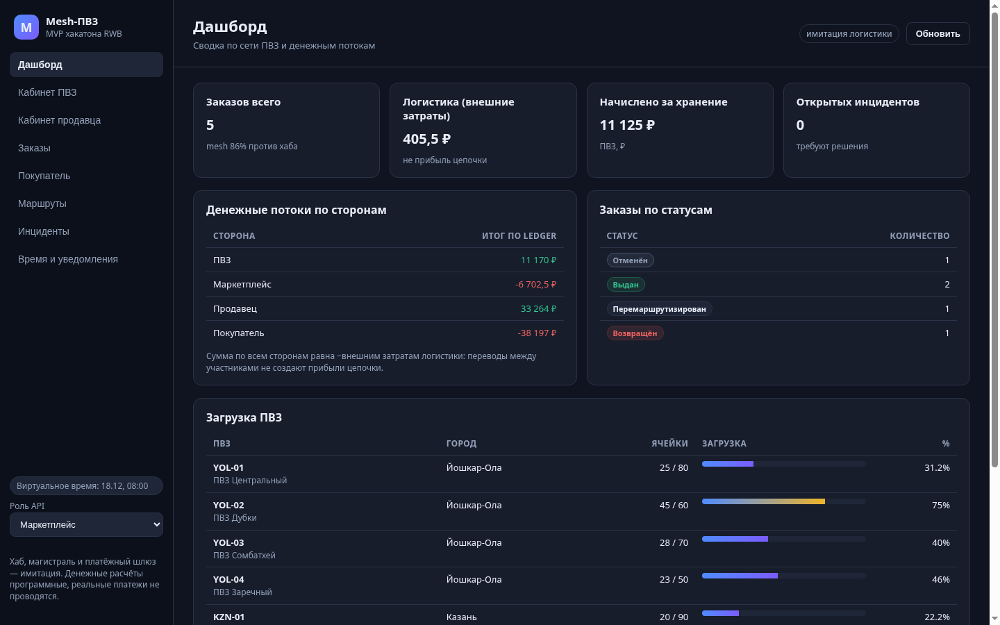
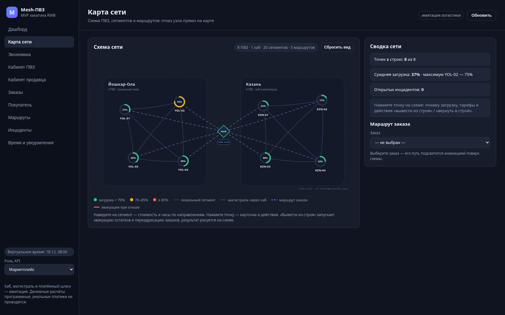
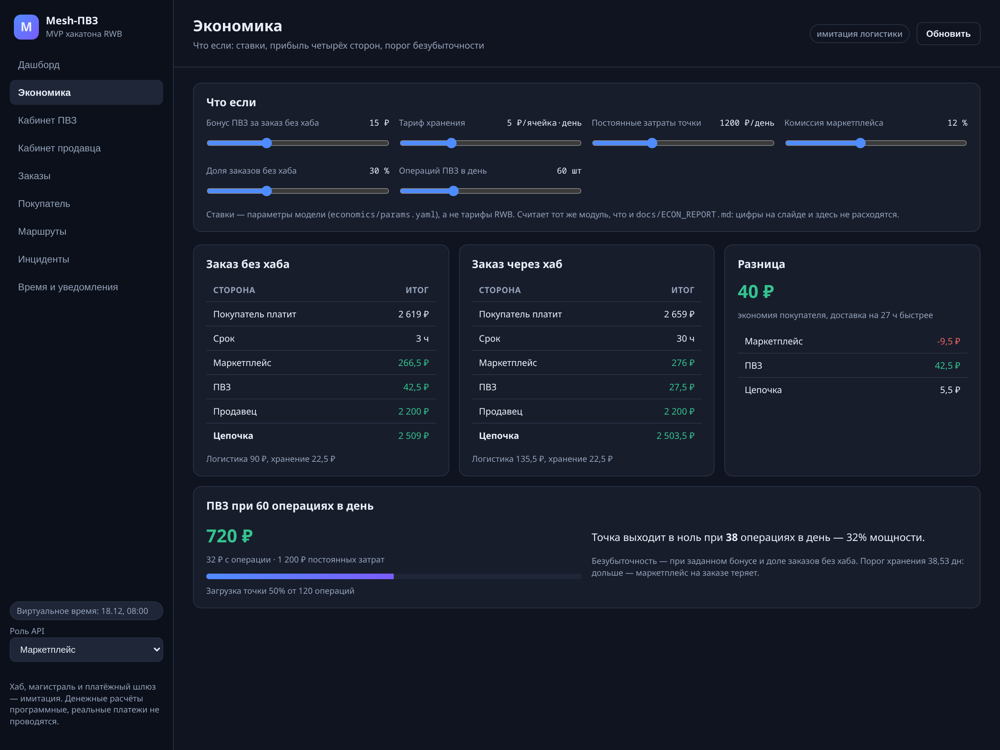
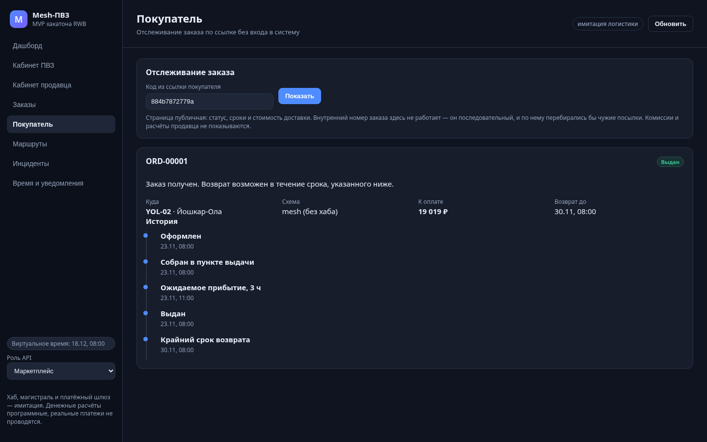
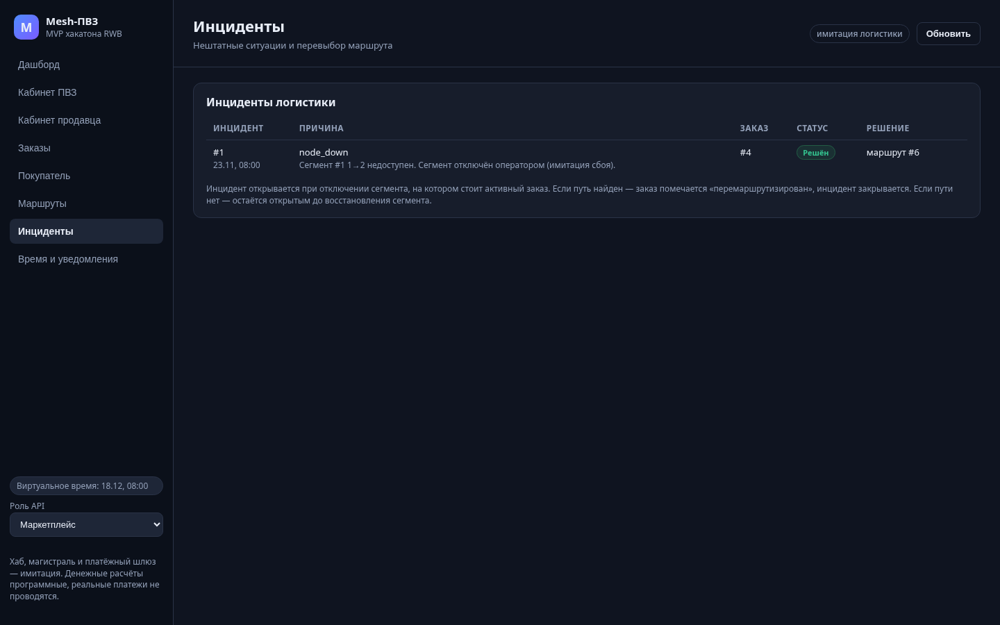

# Mesh-ПВЗ — MVP доставки с хранением в пунктах выдачи

Учебный прототип для хакатона RWB (трек «Mesh-доставка с хранением в ПВЗ»). Показывает, как заказ
собирается не на складе маркетплейса, а из остатка, который уже лежит в ПВЗ: маршрут строится по сети
точек, хаб и магистраль используются только там, где это выгодно, а хранение и операции ПВЗ оплачиваются
по прозрачным правилам.

Всё в репозитории работает локально и воспроизводимо: реальные платежи, перевозки и доступы к
производственным системам не нужны. Хаб, магистраль и платёжный шлюз — **явно помеченные заглушки**.

## Что внутри

| Компонент | Что делает |
|---|---|
| `api/` | FastAPI + SQLAlchemy (SQLite): приёмка, заказы, маршрутизация mesh/hub, выдача, возвраты и отмена, инциденты, виртуальные часы, аналитика, ledger; роли по API-ключам |
| `web/` | Рабочее место ПВЗ и продавца (одно приложение с ролями) + страница покупателя, nginx + vanilla JS, без сборки |
| `economics/` | Экономическая модель (`model.py`), параметры (`params.yaml`) со схемой проверки, сценарии «что если» (`scenario.py`), симуляция дня сети (`network.py`), генератор отчёта (`report.py`) |
| `api/tests/`, `economics/tests/` | **145 тестов**: 131 в API (включая 5 демо-сценариев и контрактные тесты OpenAPI) и 14 в экономике (модель, сценарии, симуляция дня) |
| `docs/` | Экономический отчёт, описание API, сценарии, план тиражирования и техплан, вклад участников |

## Быстрый старт (Docker)

```bash
# production-режим: собранные образы, код и статика внутри контейнеров
docker compose up -d --build

# dev-режим: api/ смонтирован с --reload, web/src отдаётся напрямую
docker compose -f docker-compose.yml -f docker-compose.dev.yml up -d --build
```

* UI: http://localhost:5173
* API и Swagger: http://localhost:8000/docs
* Проверка: `curl http://localhost:8000/health`, инварианты данных — `curl http://localhost:8000/api/v1/health/deep`

Первый запуск создаёт базу и заполняет её тестовыми данными (8 ПВЗ в Йошкар-Оле и Казани, хаб,
2 продавца, 6 товаров). Сбросить состояние:

```bash
docker compose down -v && docker compose up -d --build
```

> **После правок кода или фронта образ нужно пересобрать.** `web/src` и `api/` в production-режиме
> запекаются в образ: без `docker compose up -d --build` на :5173 и :8000 останется старый код.
> В dev-режиме (`docker-compose.dev.yml`) исходники смонтированы, и пересборка нужна только после
> изменения зависимостей или Dockerfile.

### Роли и ключи API

Чтение и отслеживание заказа открыты, запись — по заголовку `X-API-Key` с ключом роли:

| Роль | Ключ по умолчанию | Что может |
| --- | --- | --- |
| ПВЗ | `demo-pvz-key` | сборка, транзит, выдача, возврат, перемещение остатка, закрытие инцидентов |
| Продавец | `demo-seller-key` | создание заказа и партии товара, отмена заказа |
| Маркетплейс | `demo-admin-key` | всё, включая сегменты сети и виртуальные часы |

Ключи задаются переменными `MESH_PVZ_KEY`, `MESH_SELLER_KEY`, `MESH_ADMIN_KEY` (см. `docker-compose.yml`).
В UI роль переключается селектором в левом нижнем углу. Демонстрационные ключи — не секреты,
в продакшене их заменяют на выдачу реальных токенов.

В Swagger (`/docs`) есть кнопка **Authorize**: вставленный `X-API-Key` подставляется во все write-запросы.
Ответы описаны Pydantic-схемами, списки (`/orders`, `/items`, `/ledger`) поддерживают `limit`/`offset`
и отдают `X-Total-Count`. Покупатель получает ссылку вида `/?track=<токен>` — публичный поиск идёт
только по случайному токену, последовательный `ORD-00001` для этого не принимается.

## Запуск без Docker

```bash
python3 -m venv .venv
.venv/bin/pip install -r api/requirements.txt

cd api
DATABASE_URL=sqlite:///../mesh.db ../.venv/bin/uvicorn app.main:app --reload --port 8000
```

UI без Docker: откройте `web/src/index.html` нельзя (нужен прокси на API) — используйте
`python3 -m http.server` вместе с прокси или просто Docker-вариант. Для разработки удобнее
`docker compose up web`.

## Тесты

```bash
# API: 131 тест (эндпоинты, 5 демо-сценариев, инварианты, контракт OpenAPI)
cd api && DATABASE_URL=sqlite:////tmp/mesh-pytest.db ../.venv/bin/python -m pytest tests -q --tb=short

# Экономика: 14 тестов (модель, сценарии, отчёт, симуляция)
cd .. && .venv/bin/python -m pytest economics/tests -q --tb=short

# Все сразу
bash scripts/run_tests.sh
```

Сценарии с печатью отчёта: `cd api && ../.venv/bin/python -m pytest tests/test_scenarios.py -s -q`.

CI (`.github/workflows/ci.yml`) гоняет то же самое на Python 3.11/3.12 и дополнительно: `node --check`
для фронта, сверку перегенерированного OpenAPI с `docs/openapi.json` (по распарсенному JSON, не по
байтам) и проверку, что `docs/SCALE.md` не устарел. Все джобы работают на SQLite в `/tmp`, без Docker
и внешней сети.

## Как пользоваться 

Все экраны — одно приложение на http://localhost:5173. Роль переключается селектором **«Роль API»**
в левом нижнем углу: от неё зависит, какие кнопки записи доступны (маркетплейс/админ видят всё,
ПВЗ — только свои операции, продавец — свои заказы). Скриншоты сняты на тестовых данных: 5 заказов,
виртуальное время 18.12.

Короткий маршрут для проверки: **Карта сети → Кабинет продавца → Заказы → Покупатель → Маршруты →
Инциденты → Демо-кокпит → Время и уведомления**.

### Дашборд



Сводка по сети: сколько заказов в работе, сколько стоила логистика, какая доля маршрутов ушла мимо
хаба, где заканчиваются ячейки. Ниже — лента событий и таблица загрузки точек: полоса зеленеет до
половины порога предупреждения, желтеет до порога, дальше красная. Порог берётся из ответа API
(`queue_threshold.alert_pct`), а не задан в вёрстке.

### Карта сети



Схема ПВЗ вместо таблицы: два города, магистральный хаб между ними, кольца загрузки и стоимость
сегментов по наведению. Выбранный заказ подсвечивается анимацией пути, а кнопка «Вывести из строя»
прямо на карте запускает процедуру отказа узла — эвакуацию остатков (красные дуги с числом ячеек)
и переадресацию заказов; всё, что не удалось решить автоматически, уходит в инциденты. Это не
географическая карта: схема показывает топологию сети и цены сегментов, а не улицы.

### Экономика



Живой калькулятор тех же чисел, что на слайде: четыре ползунка меняют расчёт — бонус ПВЗ за заказ
без хаба, доля заказов без хаба, срок хранения и число операций в день; остальные ставки модели
показаны рядом только для чтения (API принимает их query-параметрами, но в интерфейсе оставлены
подписями к расчёту). Пересчёт идёт через `economics/scenario.py` — тот же модуль, что
строит `docs/ECON_REPORT.md`, поэтому цифры на сцене и на экране не расходятся. Запросы
дебаунсятся (350 мс), устаревшие ответы отменяются, все числа — из `GET /api/v1/economics/scenario`.

Первый блок страницы — **«Зелёная зона 4 сторон»**: чек-лист из четырёх условий (Δ прибыли ПВЗ > 0,
Δ маркетплейса ≥ 0, Δ продавца ≥ 0, Δ покупателя < 0 и по цене, и по сроку) с фактом, порогом и
статусом. Заголовок «зелёная зона: ДА/НЕТ» вычисляется из `order.compare`, рядом — границы
приемлемости покупателя (`buyer_acceptance`) и таблица четырёх сторон hub vs mesh с Δ и Δ%.
Если условия не выполнены, блок краснеет; если API не дал поле — пишется «нет данных», а не ноль.

### Демо-кокпит

Пять сценариев на живом API с кнопками и статусом PASS/FAIL: спокойный день → пиковая нагрузка
(приёмка партии доводит точку до порога overflow) → отказ узла (`disable`) → восстановление
(`enable`) → переключение на хаб. Каждый шаг вызывает реальные эндпоинты, печатает фактические
цифры из ответа и складывает их в «Лог различий» (маршрут, загрузка, опоздания, деньги); в шапке —
итог «N/5». Кокпит меняет состояние стенда: принимает демо-партию, выводит и возвращает точку,
создаёт межгородской заказ. Тот же прогон из терминала — `scripts/demo.py`.

### Кабинет ПВЗ


Рабочее место точки: остаток по партиям, свободные ячейки, начисления за хранение и операции.
Кнопки по заказу — «Собрать» и «Выдать»; ниже — приёмка новой партии и перемещение остатка на другую
точку (та самая рекомендация, которая приходит при длительном хранении). В шапке — прибыль за период:
доход по ledger минус операции и постоянные расходы точки, рядом — `audit_accuracy_pct` (точность
аудита), `audit_sla_rating` и время последней сверки.

Два блока прямо связаны с API:
**«Скоринг размещения»** — форма (SKU, количество, ячеек на штуку, опционально спрос и
оборачиваемость) уходит в `POST /catalog/placement-score`; в ответе показываются score против порога,
рекомендация «оставить в ПВЗ города» / «выгоднее через хаб», уверенность, таблица компонентов с
весами и баллами и список причин.
**«Сверка остатков»** — таблица партий с вводом фактического количества, отправка в
`POST /pvz/{id}/audit`: расхождения по строкам, удержания, точность до/после и SLA-рейтинг.
Повторная сверка с тем же фактом идемпотентна — новых удержаний не появляется.

### Кабинет продавца


Продавец видит выручку, комиссию маркетплейса (12%) и своё нетто. Форма «Оформить заказ» выбирает
товар, количество и пункт выдачи: остаток списывается с той точки, где он лежит, поэтому доставка
не начинается со склада. Галочка «допустимо увеличение срока» разрешает маршрут через хаб, если
он дешевле.

### Заказы


Единый список со статусами (зарезервирован → собран → выдан / возвращён / отменён / перемаршрутизирован),
суммами и кнопками по роли. «Ссылка покупателю» копирует публичный адрес с токеном, «Начисления»
показывает проводки именно этого заказа — удобно проверять, что суммы сходятся.

### Покупатель



Публичная страница без входа: статус, сроки, стоимость доставки и что происходит дальше. Открывается
по ссылке `/?track=<токен>`; тот же ответ отдаёт `GET /api/v1/track/{token}`. Номер заказа вида
`ORD-00001` здесь не работает — он последовательный, и по нему перебирались бы чужие посылки.

### Маршруты и сеть


Сравнение двух схем на одном запросе: внутри города mesh даёт 90 ₽ и 3 ч против 135,5 ₽ и 30 ч через
хаб в Казани. Ответ `GET /api/v1/routes/compare` содержит не только цифры, но и машинное основание
выбора: `reason_code` (`mesh_same_city`, `mesh_cheapest`, `hub_cheaper`, `hub_required`,
`overflow_to_hub`, `no_route`) и флаг `overflow` — заказ ушёл на хаб из-за загрузки точки не ниже 85%.
Внизу — сегменты сети с кнопкой «Отключить»: это ручка для демонстрации инцидентов.

### Инциденты



Каждое отключение сегмента, задевшее активный заказ, попадает сюда: что отключено, сколько заказов
затронуто, перестроен маршрут или путь не найден. Сегмент можно вернуть — инцидент закроется сам.

### Время и уведомления


Виртуальные часы двигают модель без ожидания реальных суток: сдвиг на 25 дней начисляет хранение
(5 ₽ за ячейку в день), создаёт уведомления о длительном хранении и предложение переместить остаток.
Здесь же — лента уведомлений по ролям.

## Демонстрация одной командой

Те же пять сценариев, что в разделе «Демо-кокпит», против запущенного API:

```bash
python3 scripts/demo.py            # API_URL=http://localhost:8000 по умолчанию
API_URL=http://localhost:8001 MESH_API_KEY=demo-admin-key python3 scripts/demo.py
python3 scripts/record_demo.py     # то же + docs/demo-backup.mp4 (реальный прогон в видео)
```

`scripts/demo.py` печатает PASS/FAIL по каждому шагу и итог «5/5», а не «успех» без чисел. Скрипт
самодостаточен по данным и работает на «грязной» базе: пару ПВЗ выбирает по фактической загрузке,
пиковую нагрузку создаёт переносом остатков внутри города (запас ячеек не растёт), демо-партии
прошлых прогонов выдаёт через обычный заказ и освобождает место, SKU подбирает уникальный,
отключённую точку возвращает в строй. Подробный сценарий записи —
[docs/VIDEO_DEMO_SCRIPT.md](docs/VIDEO_DEMO_SCRIPT.md).

## Масштаб

`scripts/simulate.py` прогоняет детерминированный день сети: 500 заказов, 8 точек, фиксированный seed,
два режима — mesh и «только хаб» на одном и том же потоке. Сравниваются средний срок, p95, стоимость
логистики на заказ и загрузка точек. Числа и допущения — в [docs/SCALE.md](docs/SCALE.md); коротко:
до 960 заказов в день (8 точек × 120 операций) сеть держит срок, дальше растут опоздания, а стоимость
логистики на заказ почти не меняется — узкое место не деньги, а мощность точек.

```bash
.venv/bin/python scripts/simulate.py --orders 100,500,2000 --write-md docs/SCALE.md
```


## Ключевые правила модели

* Хранение — 5 ₽ за ячейку в день, платит маркетплейс, получает ПВЗ.
* Выдача — 25 ₽ ПВЗ; заказ без хаба — ещё 15 ₽ бонуса.
* Длительное хранение — с 21 дня или 600 ₽: уведомление и предложение перемещения за 60 ₽.
* Возврат — удержание 60 ₽ за обратную логистику, срок возврата 7 дней.
* Отмена возможна до выдачи: резерв снимается, ячейки возвращаются на ПВЗ-источник, логистика не начисляется.
* Покупатель отслеживает заказ по ссылке с токеном: `GET /track/{token}` и раздел «Покупатель» — без комиссий и расчётов продавца. Последовательный код заказа для публичного поиска не работает: его слишком легко перебрать.
* Магистраль не возит внутри города: для заказа, где отправка и получение в одном городе, выбранной
  схемой всегда остаётся mesh, а хаб показывается только в сравнении как альтернатива.
* Межгородской заказ выдаётся только после транзита: `issue` для собранного заказа через хаб даёт 409.
* Партия при сборке разделяется: в заказ уходит проданное количество, остаток остаётся на ПВЗ-источнике.
* Переводы между участниками **не создают прибыли цепочки**: результат = оплата покупателя − внешние
  затраты логистики − операционные затраты ПВЗ. Проверяется тестами.
* Все тарифы — параметры предложенной модели, а не действующие тарифы RWB (`economics/params.yaml`,
  поле `meta.disclaimer`).

## Документы

* [docs/ECON_MODEL.md](docs/ECON_MODEL.md) — модель, допущения, формулы, границы применимости.
* [docs/ECON_REPORT.md](docs/ECON_REPORT.md) — расчёты по четырём сторонам, сравнение схем, пороги.
* [docs/API.md](docs/API.md) — эндпоинты, модели данных, идемпотентность, скоринг и инвентаризация.
* [docs/SCENARIOS.md](docs/SCENARIOS.md) — демо-сценарии и что проверяет каждый.
* [docs/SCALE.md](docs/SCALE.md) — что происходит при 100/500/2000 заказах в день: срок, p95, узкие места.
* [docs/REDTEAM.md](docs/REDTEAM.md) — 10 жёстких вопросов жюри с ответами и числами.
* [docs/PILOT.md](docs/PILOT.md) — план пилота на 30 дней: гипотезы, метрики, критерии остановки.
* [docs/REPLICATION.md](docs/REPLICATION.md) — план тиражирования, метрики, риски и техплан.
* [docs/SUBMISSION.md](docs/SUBMISSION.md) — чек-лист сдачи: запуск, демо, ключевые числа, ограничения.
* [docs/PROVENANCE.md](docs/PROVENANCE.md) — откуда взято каждое число и как воспроизвести артефакты.
* [docs/CONTRIBUTORS.md](docs/CONTRIBUTORS.md) — вклад участников и история коммитов.
* [docs/demo-backup.mp4](docs/demo-backup.mp4) — backup-видео: реальный прогон `scripts/demo.py` (30 с, включая ссылку покупателю).
* [docs/openapi.json](docs/openapi.json) — машинночитаемая OpenAPI-схема (40 путей, схемы ответов и `ApiKey`).
* `scripts/backup_db.py` — резервная копия SQLite без остановки API; `scripts/run_tests.sh` — все проверки.

## Ограничения MVP

* SQLite и один процесс API — без горизонтального масштабирования и очередей.
* Платёжный шлюз, хаб и магистраль — имитация; расчёты ведутся в ledger, денег не двигаем.
* Клиент покупателя не реализован: стоимость и срок видит продавец/оператор.
* Роли разграничены по API-ключам на сервере; отдельного логина пользователя нет — UI лишь переключает ключ.
* Реальные SLA, штрафы и юридические обязательства не моделируются — только параметры предложения.
