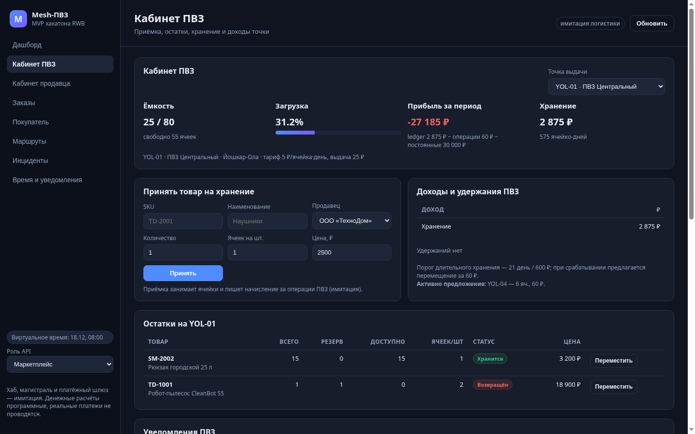
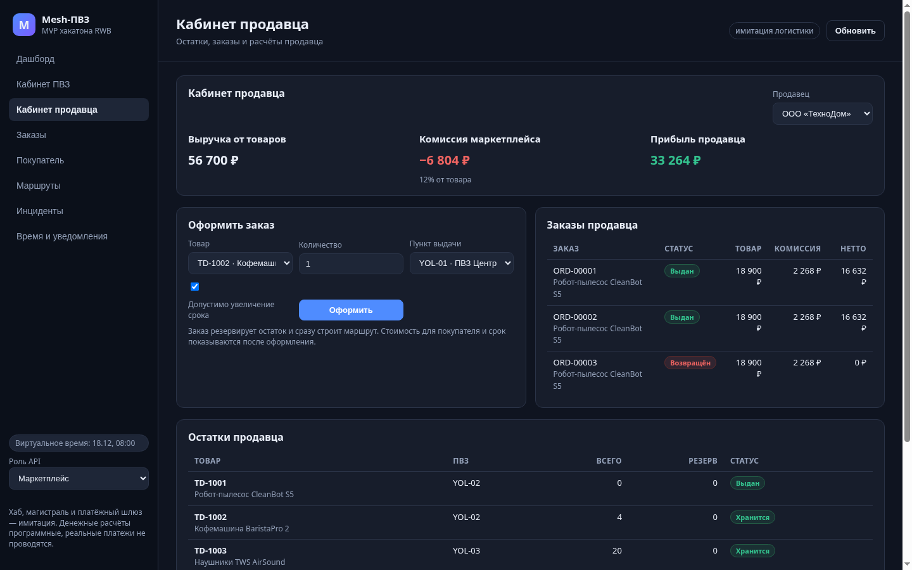
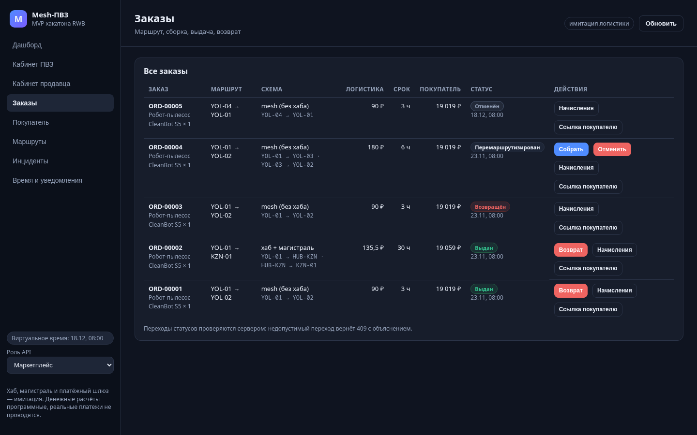
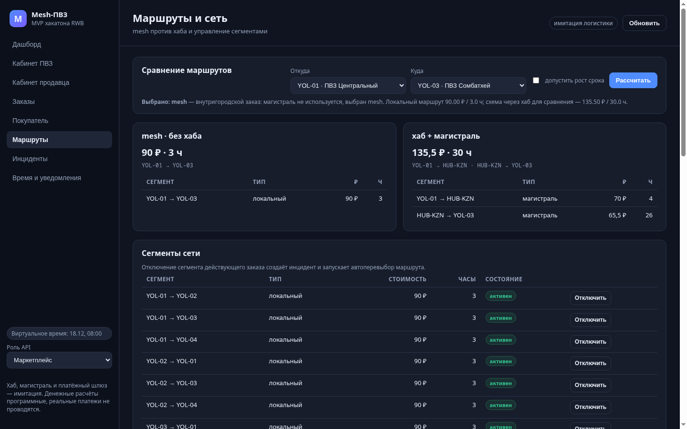
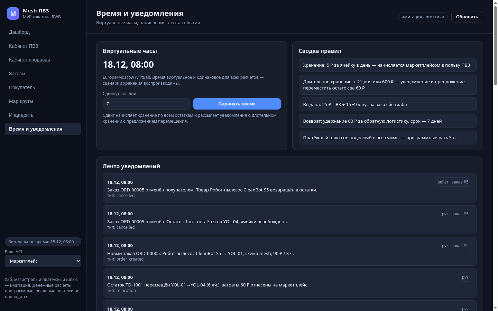

# Mesh-ПВЗ — MVP доставки с хранением в пунктах выдачи

Учебный прототип для хакатона RWB (трек «Mesh-доставка с хранением в ПВЗ»). Показывает, как заказ
собирается не на складе маркетплейса, а из остатка, который уже лежит в ПВЗ: маршрут строится по сети
точек, хаб и магистраль используются только там, где это выгодно, а хранение и операции ПВЗ оплачиваются
по прозрачным правилам.

Всё в репозитории работает локально и воспроизводимо: реальные платежи, перевозки и доступы к
производственным системам не нужны. Хаб, магистраль и платёжный шлюз — **явно помеченные заглушки**.

## Что внутри

| Компонент | Что делает |
|---|---|
| `api/` | FastAPI + SQLAlchemy (SQLite): приёмка, заказы, маршрутизация mesh/hub, выдача, возвраты и отмена, инциденты, виртуальные часы, аналитика, ledger; роли по API-ключам |
| `web/` | Рабочее место ПВЗ и продавца (одно приложение с ролями) + страница покупателя, nginx + vanilla JS, без сборки |
| `economics/` | Экономическая модель (`model.py`), параметры (`params.yaml`) со схемой проверки, генератор отчёта (`report.py`) |
| `api/tests/`, `economics/tests/` | 75 API-тестов и 9 тестов модели, включая 6 демо-сценариев |
| `docs/` | Экономический отчёт, описание API, сценарии, план тиражирования и техплан, вклад участников |

## Быстрый старт (Docker)

```bash
docker compose up --build
```

* UI: http://localhost:5173
* API и Swagger: http://localhost:8000/docs
* Проверка: `curl http://localhost:8000/health`, инварианты данных — `curl http://localhost:8000/api/v1/health/deep`

Первый запуск создаёт базу и заполняет её тестовыми данными (8 ПВЗ в Йошкар-Оле и Казани, хаб,
2 продавца, 6 товаров). Сбросить состояние:

```bash
docker compose down -v && docker compose up --build
```

### Роли и ключи API

Чтение и отслеживание заказа открыты, запись — по заголовку `X-API-Key` с ключом роли:

| Роль | Ключ по умолчанию | Что может |
| --- | --- | --- |
| ПВЗ | `demo-pvz-key` | сборка, транзит, выдача, возврат, перемещение остатка, закрытие инцидентов |
| Продавец | `demo-seller-key` | создание заказа и партии товара, отмена заказа |
| Маркетплейс | `demo-admin-key` | всё, включая сегменты сети и виртуальные часы |

Ключи задаются переменными `MESH_PVZ_KEY`, `MESH_SELLER_KEY`, `MESH_ADMIN_KEY` (см. `docker-compose.yml`).
В UI роль переключается селектором в левом нижнем углу. Демонстрационные ключи — не секреты,
в продакшене их заменяют на выдачу реальных токенов.

В Swagger (`/docs`) есть кнопка **Authorize**: вставленный `X-API-Key` подставляется во все write-запросы.
Ответы описаны Pydantic-схемами, списки (`/orders`, `/items`, `/ledger`) поддерживают `limit`/`offset`
и отдают `X-Total-Count`. Покупатель получает ссылку вида `/?track=<токен>` — публичный поиск идёт
только по случайному токену, последовательный `ORD-00001` для этого не принимается.

## Запуск без Docker

```bash
python3 -m venv .venv
.venv/bin/pip install -r api/requirements.txt

cd api
DATABASE_URL=sqlite:///../mesh.db ../.venv/bin/uvicorn app.main:app --reload --port 8000
```

UI без Docker: откройте `web/src/index.html` нельзя (нужен прокси на API) — используйте
`python3 -m http.server` вместе с прокси или просто Docker-вариант. Для разработки удобнее
`docker compose up web`.

## Тесты

```bash
# API (75 тестов, включая 6 демо-сценариев)
cd api && ../.venv/bin/python -m pytest tests -q

# Экономика (9 тестов на ручных числах + сборка отчёта)
cd .. && .venv/bin/python -m pytest economics/tests -q

# Все сразу
bash scripts/run_tests.sh
```

Сценарии с печатью отчёта: `cd api && ../.venv/bin/python -m pytest tests/test_scenarios.py -s -q`.

## Как пользоваться (скриншоты)

Все экраны — одно приложение на http://localhost:5173. Роль переключается селектором **«Роль API»**
в левом нижнем углу: от неё зависит, какие кнопки записи доступны (маркетплейс/админ видят всё,
ПВЗ — только свои операции, продавец — свои заказы). Скриншоты сняты на тестовых данных: 5 заказов,
виртуальное время 18.12.

Короткий маршрут для проверки: **Кабинет продавца → Заказы → Покупатель → Маршруты → Инциденты →
Время и уведомления**.

### Дашборд


Сводка по сети: сколько заказов в работе, сколько стоила логистика, какая доля маршрутов ушла мимо
хаба, где заканчиваются ячейки. Ниже — лента событий и таблица загрузки точек: полоса зеленеет до
70%, желтеет до 85%, дальше красная.

### Кабинет ПВЗ



Рабочее место точки: остаток по партиям, свободные ячейки, начисления за хранение и операции.
Кнопки по заказу — «Собрать» и «Выдать»; ниже — приёмка новой партии и перемещение остатка на другую
точку (та самая рекомендация, которая приходит при длительном хранении). В шапке — прибыль за период:
доход по ledger минус операции и постоянные расходы точки.

### Кабинет продавца



Продавец видит выручку, комиссию маркетплейса (12%) и своё нетто. Форма «Оформить заказ» выбирает
товар, количество и пункт выдачи: остаток списывается с той точки, где он лежит, поэтому доставка
не начинается со склада. Галочка «допустимо увеличение срока» разрешает маршрут через хаб, если
он дешевле.

### Заказы



Единый список со статусами (зарезервирован → собран → выдан / возвращён / отменён / перемаршрутизирован),
суммами и кнопками по роли. «Ссылка покупателю» копирует публичный адрес с токеном, «Начисления»
показывает проводки именно этого заказа — удобно проверять, что суммы сходятся.

### Покупатель


Публичная страница без входа: статус, сроки, стоимость доставки и что происходит дальше. Открывается
по ссылке `/?track=<токен>`; тот же ответ отдаёт `GET /api/v1/track/{token}`. Номер заказа вида
`ORD-00001` здесь не работает — он последовательный, и по нему перебирались бы чужие посылки.

### Маршруты и сеть



Сравнение двух схем на одном запросе: внутри города mesh даёт 90 ₽ и 3 ч против 135,5 ₽ и 30 ч через
хаб в Казани. Внизу — сегменты сети с кнопкой «Отключить»: это ручка для демонстрации инцидентов.

### Инциденты


Каждое отключение сегмента, задевшее активный заказ, попадает сюда: что отключено, сколько заказов
затронуто, перестроен маршрут или путь не найден. Сегмент можно вернуть — инцидент закроется сам.

### Время и уведомления



Виртуальные часы двигают модель без ожидания реальных суток: сдвиг на 25 дней начисляет хранение
(5 ₽ за ячейку в день), создаёт уведомления о длительном хранении и предложение переместить остаток.
Здесь же — лента уведомлений по ролям.

## Демонстрация одной командой

Полный сценарий против запущенного API (он же используется для backup-видео):

```bash
python3 scripts/demo.py            # API_URL=http://localhost:8000 по умолчанию
python3 scripts/record_demo.py     # то же + docs/demo-backup.mp4 (реальный прогон в видео)
```

`scripts/demo.py` самодостаточен по данным: если нужного остатка нет, он принимает демо-партию на
точке с максимальным запасом ячеек, поэтому прогон повторяем и на «грязной» базе. Скрипт печатает и
ссылку покупателю на каждый созданный заказ.

## Выступление

Слайды (речь — в заметках докладчика), текст с таймингом, план живого демо на 90 секунд
и ответы на 12 вопросов жюри: `docs/pitch/` — `RWB-Mesh-PVZ-pitch.pptx` и `SPEECH.md`.
Там же PDF — для проверки вёрстки на чужой машине.

## Ключевые правила модели

* Хранение — 5 ₽ за ячейку в день, платит маркетплейс, получает ПВЗ.
* Выдача — 25 ₽ ПВЗ; заказ без хаба — ещё 15 ₽ бонуса.
* Длительное хранение — с 21 дня или 600 ₽: уведомление и предложение перемещения за 60 ₽.
* Возврат — удержание 60 ₽ за обратную логистику, срок возврата 7 дней.
* Отмена возможна до выдачи: резерв снимается, ячейки возвращаются на ПВЗ-источник, логистика не начисляется.
* Покупатель отслеживает заказ по ссылке с токеном: `GET /track/{token}` и раздел «Покупатель» — без комиссий и расчётов продавца. Последовательный код заказа для публичного поиска не работает: его слишком легко перебрать.
* Магистраль не возит внутри города: для заказа, где отправка и получение в одном городе, выбранной
  схемой всегда остаётся mesh, а хаб показывается только в сравнении как альтернатива.
* Межгородской заказ выдаётся только после транзита: `issue` для собранного заказа через хаб даёт 409.
* Партия при сборке разделяется: в заказ уходит проданное количество, остаток остаётся на ПВЗ-источнике.
* Переводы между участниками **не создают прибыли цепочки**: результат = оплата покупателя − внешние
  затраты логистики − операционные затраты ПВЗ. Проверяется тестами.
* Все тарифы — параметры предложенной модели, а не действующие тарифы RWB (`economics/params.yaml`,
  поле `meta.disclaimer`).

## Документы

* [docs/ECON_MODEL.md](docs/ECON_MODEL.md) — модель, допущения, формулы, границы применимости.
* [docs/ECON_REPORT.md](docs/ECON_REPORT.md) — расчёты по четырём сторонам, сравнение схем, пороги.
* [docs/API.md](docs/API.md) — эндпоинты, модели данных, идемпотентность.
* [docs/SCENARIOS.md](docs/SCENARIOS.md) — 5 демо-сценариев и что проверяет каждый.
* [docs/REPLICATION.md](docs/REPLICATION.md) — план тиражирования, метрики, риски и техплан.
* [docs/CONTRIBUTORS.md](docs/CONTRIBUTORS.md) — вклад участников и история коммитов.
* [docs/demo-backup.mp4](docs/demo-backup.mp4) — backup-видео: реальный прогон `scripts/demo.py` (30 с, включая ссылку покупателю).
* [docs/openapi.json](docs/openapi.json) — машинночитаемая OpenAPI-схема (36 путей, схемы ответов и `ApiKey`).
* `scripts/backup_db.py` — резервная копия SQLite без остановки API; `scripts/run_tests.sh` — все проверки.

## Ограничения MVP

* SQLite и один процесс API — без горизонтального масштабирования и очередей.
* Платёжный шлюз, хаб и магистраль — имитация; расчёты ведутся в ledger, денег не двигаем.
* Клиент покупателя не реализован: стоимость и срок видит продавец/оператор.
* Аутентификация и роли на сервере не разграничены (UI разделён по ролям).
* Реальные SLA, штрафы и юридические обязательства не моделируются — только параметры предложения.
